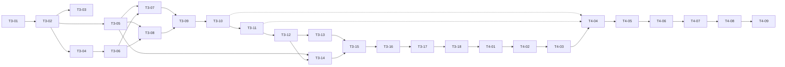

# 系统设计报告

| 项目 | 内容 |
|---|---|
| 文档名称 | 系统设计报告 |
| 项目名称 | 智能日报生成器 daily-report v2.0 |
| 代码基线 | feature 分支（含第 4 周考勤变更） |
| 编写日期 | 2026 年 11 月 26 日 |
| 参考文档 | `specs/proposal.md` · `specs/design.md` · `specs/tasks.md` · `docs/需求分析报告.md` · `docs/业务调研报告.md` · `docs/系统分析报告.md` |

---

## 目 录

- [第1章 设计概述](#第1章-设计概述)
- [第2章 界面原型与交互说明](#第2章-界面原型与交互说明)
- [第3章 工程目录结构与部署设计](#第3章-工程目录结构与部署设计)
- [第4章 任务分解（tasks.md 摘要与依赖图）](#第4章-任务分解tasksmd-摘要与依赖图)
- [第5章 测试用例设计与执行结果](#第5章-测试用例设计与执行结果)
- [第6章 规范符合性说明（与 specs/ 一致性自查）](#第6章-规范符合性说明与-specs-一致性自查)

---

## 第1章 设计概述

### 1.1 设计目标

本系统是“智能日报生成器”v2.0 迭代，目标是为小型研发团队自动汇总每日工作痕迹，生成个人与团队日报，并通过邮件、飞书群机器人两种渠道推送，减少手工回忆、复制粘贴与口径不一的问题。关键设计目标如下：

| 编号 | 目标 | 度量指标 | 目标值 |
|---|---|---|---|
| G-01 | 日报自动化 | 需手工补写的成员占比 | ≤ 10%（每人每日手工补充 ≤ 1 条） |
| G-02 | 数据来源覆盖 | 采集成功的数据源数 / 计划数据源数 | = 4/4（GitHub、飞书任务、飞书消息、飞书考勤） |
| G-03 | 条目可追溯率 | 可回溯到原始记录的条目 / 全部条目 | = 100% |
| G-04 | 生成时效 | 定时触发到推送完成耗时（≤ 10 人组） | ≤ 5 分钟 |
| G-05 | 稳定性 | 连续 5 个工作日定时任务成功率 | ≥ 95%（允许单模块失败降级） |
| G-06 | 格式一致性 | 团队日报符合统一模板的字段完整度 | = 100% |
| G-07 | 数据留存 | 日报历史可查询天数 | ≥ 90 天 |

### 1.2 设计原则

本系统在设计过程中遵循以下原则：

1. **分层 + 端口适配器**：采集、生成、推送三层只依赖共享基础层，编排入口统一调度；真实实现与 Mock 实现共享同一 Protocol，测试与生产可切换。
2. **幂等与失败隔离**：任何单源、单人、单渠道失败均不中断整体流程，并结构化记录；重复触发不会导致重复日报与重复推送。
3. **可追溯优先**：每条日报条目必须携带 `source_type` 与 `source_id`，不引入 AI 摘要等不可核查内容。
4. **配置即代码**：成员映射通过 JSON 文件维护，密钥通过环境变量注入，禁止硬编码。
5. **规范优先于实现**：`specs/` 为最高约束，代码与规范冲突时要么改代码，要么走变更流程。

### 1.3 系统范围

#### 1.3.1 包含功能（R-01 ~ R-11）

| 编号 | 范围条目 | 说明 |
|---|---|---|
| R-01 | 采集 GitHub 提交记录 | 按 UTC 日区间、只读令牌、分页上限 |
| R-02 | 采集飞书任务流转 | 按日区间拉取任务状态变更 |
| R-03 | 采集飞书群消息 | 按日区间拉取群消息，撤回消息保留并标注 |
| R-04 | 生成个人日报 | 按成员归组，含无数据日标注 |
| R-05 | 生成团队日报 | 按成员分组汇总，格式统一，缺失成员显式标注 |
| R-06 | 邮件推送日报 | 逐收件人发送，部分失败隔离并返回结构化结果 |
| R-07 | 飞书机器人推送日报 | 群机器人 webhook 推送 |
| R-08 | SQLite 存储日报历史并支持查询 | 按日期 / 成员查询，保留 ≥ 90 天 |
| R-09 | 维护成员与采集映射配置 | 成员与 GitHub / 飞书账号映射，缺失不猜测 |
| R-10 | 定时触发全流程并保证幂等 | 同日同团队只允许一次成功运行 |
| R-11 | 采集飞书考勤数据并纳入日报（v1.1 变更） | 按日区间采集出勤/缺勤记录，作为独立来源条目进入日报 |

#### 1.3.2 明确排除项

| 编号 | 排除项 | 理由 |
|---|---|---|
| N-01 | 不做 AI 智能摘要 / 润色 | 生成内容不可核查，与“条目必须可追溯”冲突 |
| N-02 | 不做 Web 管理界面 | 本期以配置文件 + 命令行驱动，最小化实现面 |
| N-04 | 不做多团队租户隔离与权限体系 | 单团队部署，无多租户需求 |
| N-05 | 不做移动端 | 交付形态为定时任务 + 邮件/机器人 |

> 注：N-03“不采集考勤数据”已由 R-11 替代，考勤采集已纳入本期并完成。

### 1.4 总体流程

系统单次运行（`run_daily`）的主流程如下：

```text
定时任务 / 手动双击 / 命令行
            │
            ▼
    ┌───────────────┐
    │   CLI 入口    │  解析参数、装载配置、初始化数据库
    └───────┬───────┘
            │
            ▼
    ┌───────────────┐
    │   幂等检查    │  查询当日最近一次运行；success/partial 且未 force 则跳过
    └───────┬───────┘
            │
            ▼
    ┌───────────────┐
    │   三/四源采集  │  GitHub 提交、飞书任务、飞书消息、（可选）飞书考勤
    │   失败隔离     │  单源失败不影响其余，来源缺失写入日报 note
    └───────┬───────┘
            │
            ▼
    ┌───────────────┐
    │  归组与生成    │  attribution → builder → 个人日报 + 团队日报
    │  缺失映射不猜测 │  未配置映射成员写入 note，不捏造归属
    └───────┬───────┘
            │
            ▼
    ┌───────────────┐
    │  渲染与推送    │  纯文本 / HTML 渲染；邮件 + 飞书机器人双渠道隔离
    │  脱敏处理     │  日志与失败原因中邮箱脱敏
    └───────┬───────┘
            │
            ▼
    ┌───────────────┐
    │  运行摘要落库  │  RunSummary 记录采集/发送/失败统计
    └───────────────┘
```

---

## 第2章 界面原型与交互说明

### 2.1 交互形态说明

本期系统为命令行 + 定时任务形态，**不提供 Web 管理界面**（N-02）。用户与系统的交互主要通过以下三种方式：

1. **命令行**：`python -m daily_report <subcommand>`
2. **Windows 批处理**：`推送日报.bat` 一键运行
3. **系统计划任务**：定时调用批处理或 CLI

### 2.2 命令行界面

#### 2.2.1 成员管理子命令

```text
$ python -m daily_report members import --file members.json --db my.db
已导入 3 名成员

$ python -m daily_report members list --db my.db
m1  张三
m2  李四  缺少：github_login
m3  王五  缺少：email
```

#### 2.2.2 运行子命令

```text
$ python -m daily_report run --team t1 --date 2026-11-26 --print --db my.db
status: success
{"collected": {"github": 5, "feishu_task": 2, "feishu_message": 3},
 "sent": {"email": 3, "feishu_bot": 1},
 "failed": {}}

============================================================
2026-11-26 团队日报

## 张三
- [github] 修复登录接口超时问题
- [github] 补充分页边界处理
- [feishu_task] 日报生成模块联调（done）
- [feishu_message] 接口已经提 PR，请帮忙 review
- [feishu_attendance] 考勤：出勤 09:12

## 李四
- [github] 补充单元测试覆盖
- [feishu_task] 飞书推送验证（open）
- [feishu_attendance] 考勤：迟到 10:30

## 王五
- [github] 整理接口文档
- [feishu_message] 今天的日报模板我调整好了
- [feishu_attendance] 考勤：请假
============================================================
```

#### 2.2.3 重复运行示例

```text
$ python -m daily_report run --team t1 --date 2026-11-26 --db my.db
status: skipped
重复触发已忽略（当日已有成功运行）
```

### 2.3 批处理界面

仓库根目录提供 `推送日报.bat`，双击即可运行：

```bat
@echo off
chcp 65001 >nul
cd /d "%~dp0"

echo ========================================
echo        智能日报 - 采集并推送
echo ========================================
echo.

.venv\Scripts\python.exe -m daily_report run --team t1 --force --print --db my.db

echo.
echo ========================================
echo 推送完成。请查看上方的 sent 字段：
echo   email: 1      表示邮件已发出
echo   feishu_bot: 1 表示飞书已推送
echo ========================================
pause
```

**说明**：

- `chcp 65001`：强制使用 UTF-8 编码，避免中文输出乱码。
- `cd /d "%~dp0"`：切换到批处理所在目录，确保 `.env` 与数据库路径正确。
- `--force`：允许当日重复运行（用于手动补推）。
- `--print`：在终端显示日报正文，便于立即核对。

### 2.4 邮件与飞书消息原型

#### 2.4.1 邮件 HTML 原型

```html
<html>
<body>
  <h2>2026-11-26 团队日报</h2>
  <ul>
    <li>[github] 张三：修复登录接口超时问题</li>
    <li>[feishu_task] 张三：日报生成模块联调（done）</li>
    <li>[feishu_attendance] 张三：考勤：出勤 09:12</li>
    <li>...</li>
  </ul>
  <p class="note">备注：来源缺失：feishu_message</p>
</body>
</html>
```

#### 2.4.2 飞书机器人消息原型

飞书机器人以 `render_team_text` 生成的纯文本形式推送，结构与终端 `--print` 输出一致，包含：

- 标题：`YYYY-MM-DD 团队日报`
- 按成员分组的条目（`## 成员名`）
- 备注：无数据 / 来源缺失 / 未配置映射成员 / 无数据成员

### 2.5 配置交互

系统配置通过 `.env` 文件或进程环境变量注入，`.env.example` 示例如下：

```env
DAILY_REPORT_SOURCE_MODE=mock
DAILY_REPORT_TIMEZONE=Asia/Shanghai
DAILY_REPORT_MAX_PAGES=10
DAILY_REPORT_RETRY_TIMES=2

GITHUB_TOKEN=ghp_xxxxxxxxxxxxxxxxxxxx
GITHUB_OWNER=demo-org
GITHUB_REPO=demo-repo
GITHUB_BRANCH=main

FEISHU_APP_ID=cli_xxxxxxxxxxxxxxxx
FEISHU_APP_SECRET=xxxxxxxxxxxxxxxxxxxxxx
FEISHU_BOT_WEBHOOK=https://open.feishu.cn/open-apis/bot/v2/hook/xxxxxxxx

SMTP_HOST=smtp.example.com
SMTP_PORT=465
SMTP_USER=daily@example.com
SMTP_PASSWORD=xxxxxxxx
```

成员映射通过 JSON 文件维护：

```json
[
  {
    "member_id": "m1",
    "name": "张三",
    "github_login": "zhangsan",
    "feishu_open_id": "ou_zhangsan",
    "email": "zhangsan@example.com",
    "git_emails": ["zhangsan@users.noreply.github.com"]
  }
]
```

---

## 第3章 工程目录结构与部署设计

### 3.1 工程目录结构

```text
diary_report_generator2/
├── .env                    # 本地运行时读取的密钥配置（不提交）
├── .env.example            # 配置模板
├── .gitignore
├── pyproject.toml          # uv 依赖、pytest / ruff 配置
├── uv.lock
├── README.md
├── members.json            # 成员映射配置示例
├── members.example.json
├── 推送日报.bat            # Windows 一键运行脚本
│
├── src/
│   └── daily_report/
│       ├── __init__.py
│       ├── __main__.py          # python -m daily_report 入口
│       ├── cli.py               # 命令行参数解析与退出码
│       ├── config.py            # 配置装配（密钥唯一读取点）
│       ├── errors.py            # 异常体系
│       ├── members.py           # 成员 JSON 加载
│       ├── models.py            # 领域模型
│       ├── net.py               # HTTP 超时与重试
│       │
│       ├── collectors/          # 采集层
│       │   ├── base.py          # 采集端口 Protocol
│       │   ├── feishu.py        # 飞书任务 / 消息 / 考勤采集
│       │   ├── github.py        # GitHub 提交采集
│       │   └── mock.py          # Mock 数据源（离线演示 / 测试）
│       │
│       ├── generation/          # 生成层
│       │   ├── attribution.py   # 原始记录 → 成员归组
│       │   └── builder.py       # 归组 → DailyReport
│       │
│       ├── orchestration/       # 编排入口
│       │   └── run_daily.py     # 幂等、失败隔离、运行摘要落库
│       │
│       ├── publishers/          # 推送层
│       │   ├── base.py          # 推送端口 Protocol
│       │   ├── email.py         # SMTP_SSL 邮件推送
│       │   ├── fake.py          # 可注入失败的测试替身
│       │   └── feishu_bot.py    # 飞书群机器人 webhook 推送
│       │
│       ├── render/              # 渲染层
│       │   └── text.py          # 纯文本 / HTML 渲染
│       │
│       └── storage/             # 持久化层
│           ├── repository.py    # 全部 SQL 与数据访问
│           └── schema.py        # SQLite DDL
│
├── tests/                       # 测试套件
│   ├── conftest.py
│   ├── test_architecture.py     # 分层依赖守护
│   ├── test_attendance.py
│   ├── test_attribution.py
│   ├── test_builder_*.py
│   ├── test_cli.py
│   ├── test_collectors_base.py
│   ├── test_config.py
│   ├── test_email_*.py
│   ├── test_errors.py
│   ├── test_feishu_*.py
│   ├── test_github_collector.py
│   ├── test_integration.py
│   ├── test_models.py
│   ├── test_net.py
│   ├── test_regression.py
│   ├── test_render.py
│   ├── test_review_fixes.py
│   ├── test_run_daily.py
│   └── test_storage.py
│
├── scripts/                     # 工具脚本
│   ├── check_spec_drift.py      # 规范守护：src 改动须伴随 specs 改动
│   └── generate_analysis_report.py
│
├── docs/                        # 文档
│   ├── 需求分析报告.md
│   ├── 系统分析报告.md
│   ├── 系统设计报告.md
│   ├── 项目总结报告.md
│   ├── 规范审计报告.md
│   ├── 安全自检记录.md
│   ├── 回归测试执行报告.md
│   ├── 变更涟漪演练记录.md
│   ├── 答辩追问清单.md
│   └── uml/                     # PlantUML 源文件
│
└── specs/                       # 最高约束规范
    ├── proposal.md              # 范围与成功标准
    ├── design.md                # 架构与数据模型
    └── tasks.md                 # 任务分解与依赖图
```

### 3.2 模块规模统计

| 模块 | 文件数 | 代码行数 | 说明 |
|---|---|---|---|
| 采集层（collectors） | 4 | 576 | 含 GitHub、飞书、Mock、端口定义 |
| 生成层（generation） | 2 | 352 | attribution + builder |
| 推送层（publishers） | 4 | 207 | email、feishu_bot、fake、端口定义 |
| 渲染层（render） | 1 | 68 | text.py |
| 持久化层（storage） | 2 | 399 | schema + repository |
| 编排与入口（cli/orchestration） | 2 | 552 | cli.py + run_daily.py |
| 共享基础层 | 5 | 524 | config、models、errors、net、members |
| **合计** | **20** | **2678** | 不含空 `__init__.py` |

### 3.3 部署设计

#### 3.3.1 运行环境

| 项 | 要求 |
|---|---|
| 操作系统 | Windows 10/11（批处理部署）、Linux / macOS（crontab/systemd） |
| Python | ≥ 3.12 |
| 包管理 | uv 0.13+ |
| 网络 | 可访问 GitHub API、飞书开放平台、SMTP 服务器、飞书 webhook |
| 存储 | 本地 SQLite 文件，预留 ≥ 1 GB（≥ 90 天历史） |

#### 3.3.2 部署步骤

1. **克隆代码**

   ```bash
   git clone <repo>
   cd diary_report_generator2
   ```

2. **安装依赖**

   ```bash
   uv sync
   ```

3. **配置环境变量**

   复制 `.env.example` 为 `.env`，填入真实凭证：

   ```bash
   cp .env.example .env
   # 编辑 .env
   ```

4. **导入成员**

   ```bash
   uv run python -m daily_report members import --file members.json --db daily_report.db
   ```

5. **手动试运行**

   ```bash
   uv run python -m daily_report run --team t1 --date 2026-11-26 --print --db daily_report.db
   ```

6. **Windows 定时任务**

   - 打开“任务计划程序”
   - 创建基本任务：每天 18:00 触发
   - 操作：启动程序 `推送日报.bat`
   - 工作目录设为仓库根目录

7. **Linux / macOS 定时任务**

   ```bash
   crontab -e
   # 添加：
   0 18 * * * cd /path/to/diary_report_generator2 && uv run python -m daily_report run --team t1 --db daily_report.db >> /var/log/daily_report.log 2>&1
   ```

#### 3.3.3 部署拓扑

```text
┌─────────────────────────────────────────────────────────────┐
│                      运行主机                                │
│  ┌─────────────┐  ┌─────────────┐  ┌─────────────────────┐  │
│  │ 系统计划任务 │  │   uv venv   │  │   SQLite daily.db   │  │
│  │  每天 18:00 │  │ python 3.12 │  │  原始记录 / 日报     │  │
│  └──────┬──────┘  └──────┬──────┘  └─────────────────────┘  │
│         │                │                                  │
│         └────────────────┼────────────────┐                 │
│                          ▼                ▼                 │
│              ┌─────────────────┐   ┌─────────────────┐      │
│              │ daily_report CLI │   │ .env（环境变量） │      │
│              └────────┬────────┘   └─────────────────┘      │
│                       │                                      │
│         ┌─────────────┼─────────────┐                       │
│         ▼             ▼             ▼                       │
│    GitHub API    飞书开放平台    SMTP / 飞书 webhook        │
└─────────────────────────────────────────────────────────────┘
```

### 3.4 配置安全

- 密钥仅通过 `.env` 或进程环境变量注入，`config.py` 是唯一读取点。
- `.env` 已加入 `.gitignore`，禁止入仓。
- `Settings` 中敏感字段 `repr=False`，避免日志泄露。
- 邮件失败原因与日志中的邮箱使用 `mask_email` 脱敏。

---

## 第4章 任务分解（tasks.md 摘要与依赖图）

### 4.1 任务分解方法

任务按**一任务 = 一交付物 = 一次提交 = 一次 code-review** 原则分解，全部任务来自 `specs/tasks.md`。第 3 周完成系统骨架与主体功能，第 4 周完成变更涟漪演练（考勤采集纳入）与交付审计。

### 4.2 第 3 周任务清单

#### 4.2.1 共享基础层

| 编号 | 任务 | 交付物 | 验收标准 | 依赖 |
|---|---|---|---|---|
| T3-01 | 工程骨架与工具链 | `pyproject.toml`、目录骨架、ruff/pytest 配置、`.env.example`、`.gitignore` | `uv sync` 成功；`ruff check .` 零告警；`pytest -q` 收集到 0 个用例且退出码 5 为预期 | — |
| T3-02 | 领域模型与异常 | `models.py`、`errors.py` | UTC 校验拒绝 naive datetime；`ReportScope` 无默认值；错误码可实例化 | T3-01 |
| T3-03 | 配置装配 | `config.py` | 缺失必需环境变量抛 `ConfigError`；不出现真实令牌；`source_mode` 支持 mock/live | T3-02 |
| T3-04 | 存储结构与仓储 | `storage/schema.py`、`storage/repository.py` | 建表幂等；原始记录按主键去重；`UNIQUE` 生效；SQL 参数化 | T3-02 |
| T3-05 | 网络请求助手 | `net.py` | 401/403 不重试；429/5xx/超时重试 2 次；其它 4xx 不重试 | T3-02 |

#### 4.2.2 采集层

| 编号 | 任务 | 交付物 | 验收标准 | 依赖 |
|---|---|---|---|---|
| T3-06 | 采集端口与 Mock 数据源 | `collectors/base.py`、`collectors/mock.py` | Mock 与 Protocol 签名一致；空区间返回 `[]`；naive datetime 抛错 | T3-04 |
| T3-07 | GitHub 采集实现 | `collectors/github.py` | 正常区间、空区间、分页截断、401 不重试、429 重试、字段逐项断言 | T3-05、T3-06 |
| T3-08 | 飞书任务与消息采集 | `collectors/feishu.py` | 任务状态变更采集；消息撤回置 `is_recalled=True`；限流退避重试 | T3-05、T3-06 |

#### 4.2.3 生成层

| 编号 | 任务 | 交付物 | 验收标准 | 依赖 |
|---|---|---|---|---|
| T3-09 | 协作归属 | `generation/attribution.py` | 按 GitHub login / 飞书 open_id 归组；未配置映射成员计入 `unmapped`；不按消息发言者推测 | T3-07、T3-08 |
| T3-10 | 个人日报生成 | `generation/builder.py`（PERSONAL） | 条目顺序正确；`source_id` 非空；无数据返回 `note="无数据"`；缺失源写入 note | T3-09 |
| T3-11 | 团队日报生成 | `generation/builder.py`（TEAM） | 按 member_id 分组；缺失成员列在 note；全组无数据仍返回非 `None` | T3-10 |

#### 4.2.4 渲染与推送层

| 编号 | 任务 | 交付物 | 验收标准 | 依赖 |
|---|---|---|---|---|
| T3-12 | 文本与邮件渲染 | `render/text.py` | 纯函数不改入参；团队日报字段完整度 100%；HTML 转义特殊字符 | T3-11 |
| T3-13 | 邮件推送 | `publishers/email.py` | 单收件人失败不中断；认证失败整批停止；邮箱脱敏 | T3-12 |
| T3-14 | 飞书机器人推送 | `publishers/feishu_bot.py` | 成功返回 `ok=True`；5xx 重试 2 次后 `ok=False`；webhook 缺失抛 `ConfigError` | T3-05、T3-12 |

#### 4.2.5 编排与交付

| 编号 | 任务 | 交付物 | 验收标准 | 依赖 |
|---|---|---|---|---|
| T3-15 | 主编排与幂等 | `orchestration/run_daily.py` | 同日二次运行返回原摘要；单源失败其余继续；推送全失败时日报仍入库 | T3-13、T3-14 |
| T3-16 | 命令行入口 | `cli.py`、`__main__.py` | `run` 退出码 0；重复运行退出码 0 并提示；参数非法退出码 2 | T3-15 |
| T3-17 | 集成测试与分层检查 | `tests/test_integration.py`、`tests/test_architecture.py` | 全链路 Mock 可重复执行；下层模块不 import `orchestration` | T3-16 |
| T3-18 | 质量收口与规范同步 | ruff 零告警、一致性检查记录 | ruff 与 pytest 全绿；一致性检查记录中代码路径真实存在 | T3-17 |

### 4.3 第 4 周任务清单（变更涟漪演练 + 交付）

| 编号 | 任务 | 交付物 | 验收标准 | 依赖 |
|---|---|---|---|---|
| T4-01 | 变更单受理与规范同步 | `proposal.md` 新增 R-11、`design.md` 新增 3.6 接口契约与 ADR-005 | 文档 diff 中可见范围、接口、数据模型三处同步；变更涟漪记录完整 | T3-18 |
| T4-02 | 任务与依赖更新 | `tasks.md` 新增 T4-03~T4-05 并更新依赖图 | 新增任务均有验收标准；依赖图中受影响节点正确标记 | T4-01 |
| T4-03 | 考勤采集实现 | `models.AttendanceRecord`、`collectors/feishu.py` 新增 `collect_attendance`、`collectors/mock.py` 同步 | `test_attendance.py` 通过：区间采集、缺勤记录、空区间返回 `[]` | T4-02 |
| T4-04 | 生成层容纳考勤条目 | `generation/builder.py` 接入考勤来源 | `test_builder_team.py` 新增用例通过；考勤条目可追溯；既有行为不回归 | T4-03 |
| T4-05 | 全量回归 | `tests/test_regression.py` | 从 `proposal.md` 成功标准逐条导出用例；pytest 全绿；回归报告逐条核对 | T4-04 |
| T4-06 | 规范守护自检 | `scripts/check_spec_drift.py` | 修改 `src/` 而未修改 `specs/` 时退出码非 0 并列出文件；规范守护记录附运行输出 | T4-05 |
| T4-07 | 安全自检 | 检索报告 | 全仓检索无令牌明文、无字符串拼接 SQL；日志脱敏用例通过；安全自检记录附检索命令与输出 | T4-06 |
| T4-08 | 答辩追问清单与模拟答辩 | `docs/答辩追问清单.md`、`docs/模拟答辩记录.md` | 追问覆盖架构 ADR、安全、异常处理、并发与幂等四类，每问有可核对答案 | T4-07 |
| T4-09 | 总结与审计报告 | `docs/项目总结报告.md`、`docs/规范审计报告.md`、`docs/AI使用合规声明.md` | 质量数据来自真实 `pytest --cov` 与 `ruff`；两阶段对比数据标注来源；无编造 | T4-08 |

### 4.4 任务依赖图



**关键路径**：T3-01 → T3-02 → T3-04 → T3-06 → T3-07 → T3-09 → T3-10 → T3-11 → T3-12 → T3-13 → T3-15 → T3-16 → T3-17 → T3-18 → T4-01 → T4-02 → T4-03 → T4-04 → T4-05 → ... → T4-09。

### 4.5 并行组

| 并行组 | 任务 | 说明 |
|---|---|---|
| P1 | T3-07 / T3-08 | 两个采集器分属不同文件，端口已定，可并行 |
| P2 | T3-13 / T3-14 | 两个推送渠道互不依赖 |
| P3 | T3-03 / T3-04 | 配置与存储无相互依赖 |

**必须串行**的共享文件：`models.py`（T3-02 唯一）、`generation/builder.py`（T3-10、T3-11、T4-04）、`orchestration/run_daily.py`（T3-15）、`specs/*.md`（每次变更单次提交）。

### 4.6 范围覆盖核对

| 范围条目 | 承接任务 | 状态 |
|---|---|---|
| R-01 GitHub 采集 | T3-07 | 已完成 |
| R-02 飞书任务采集 | T3-08 | 已完成 |
| R-03 飞书消息采集 | T3-08 | 已完成 |
| R-04 个人日报 | T3-10 | 已完成 |
| R-05 团队日报 | T3-11 | 已完成 |
| R-06 邮件推送 | T3-13 | 已完成 |
| R-07 飞书机器人推送 | T3-14 | 已完成 |
| R-08 历史存储与查询 | T3-04、T3-15 | 已完成 |
| R-09 映射配置 | T3-03、T3-08 | 已完成 |
| R-10 定时与幂等 | T3-15、T3-16 | 已完成 |
| R-11 考勤采集（第 4 周变更） | T4-03、T4-04 | 已完成 |

---

## 第5章 测试用例设计与执行结果

### 5.1 测试分层

| 层次 | 目标 | 覆盖文件 |
|---|---|---|
| 单元测试 | 各模块函数级行为、异常语义、边界条件 | `test_models`、`test_config`、`test_net`、`test_attribution`、`test_builder_*`、`test_render`、`test_storage`、`test_email_*`、`test_feishu_*`、`test_github_collector`、`test_errors`、`test_collectors_base` |
| 集成测试 | mock 源 + 测试推送器端到端跑通 `run_daily` | `test_integration.py` |
| 架构守护测试 | 分层依赖方向、端口契约 | `test_architecture.py`、`test_collectors_base.py` |
| 回归测试 | 已修复缺陷与验收标准固定为用例，防复发 | `test_regression.py`、`test_review_fixes.py` |

### 5.2 测试用例统计

| 指标 | 数值 |
|---|---|
| 测试文件 | 23 个（含 `conftest.py`） |
| 收集用例 | 130 个 |
| 通过 | 129 个 |
| 失败 | 1 个 |
| 代码覆盖率（核心模块） | 87%（1130 行中 142 行未覆盖） |

### 5.3 用例设计要点

| 测试文件 | 关键用例 | 对应验收标准 |
|---|---|---|
| `test_models.py` | UTC 校验、naive 拒绝、`ReportScope` 必填、`AttendanceRecord` 状态枚举 | AC-02、AC-10 |
| `test_config.py` | 缺失必需变量抛 `ConfigError`、source_mode 枚举、整数解析错误 | AC-08 |
| `test_net.py` | 401/403 不重试、429/5xx 重试 2 次、其它 4xx 不重试 | AC-01 |
| `test_attribution.py` | 按 login/open_id 归组、未映射成员不猜测、半配置成员记录 mapping_gaps | AC-02、AC-03 |
| `test_builder_personal.py` | 条目顺序、source_id 非空、无数据 note、缺失源 note | AC-02 |
| `test_builder_team.py` | 按成员分组、缺失成员标注、考勤条目插入位置 | AC-03、AC-10 |
| `test_builder_attendance.py` | 四种考勤状态文本、未打点语义 | AC-10 |
| `test_render.py` | 纯函数不改入参、HTML 转义、团队分组渲染 | AC-03、AC-06 |
| `test_email_pusher.py` | 单收件人失败隔离、认证失败整批停止、邮箱脱敏 | AC-04、AC-08 |
| `test_feishu_bot.py` | 成功推送、5xx 重试、webhook 缺失抛错 | AC-05 |
| `test_run_daily.py` | 幂等跳过、单源失败继续、推送全失败仍入库、force 重跑 | AC-06 |
| `test_storage.py` | 建表幂等、去重、区间过滤、日报 upsert 降级保护 | AC-07 |
| `test_integration.py` | 全链路 Mock 采集 → 生成 → 推送 | AC-01 ~ AC-06 |
| `test_architecture.py` | 下层模块不 import `orchestration`、端口 runtime_checkable | AC-09 |
| `test_regression.py` | 从 `proposal.md` 成功标准导出 | AC-01 ~ AC-10 |
| `test_review_fixes.py` | 复审修复点固定为用例 | AC-02、AC-03、AC-06、AC-08 |

### 5.4 最近执行结果（2026-11-26，feature 分支）

```text
1 failed, 129 passed in 10.82s
```

**失败用例**：`tests/test_storage.py::test_duplicate_successful_run_rejected`

**失败原因**：该用例基于旧语义编写，期望重复保存生产性 `RunSummary` 时抛出 `sqlite3.IntegrityError`。当前工作区为支持 `--force` 重跑，`save_run_summary` 已改为“先 DELETE 同键旧行再 INSERT”，幂等防护上移至 `run_daily` 的 `find_latest_run` 检查，因此不再触发唯一索引异常。

**处理建议**：

1. 更新 `test_duplicate_successful_run_rejected` 为两层断言：
   - 数据层：`save_run_summary` 对同键记录执行覆盖式幂等写入，最终只保留最新一行。
   - 编排层：非 `force` 重复调用 `run_daily` 返回 `status=skipped`。
2. 同步修订 `specs/design.md` §2.2 关于 `run_summaries` 唯一约束的描述，明确“生产性运行幂等由部分唯一索引 + run_daily 检查共同保证”。

### 5.5 覆盖率明细

| 模块 | 总行数 | 未覆盖行 | 覆盖率 |
|---|---|---|---|
| `collectors/base.py` | 31 | 0 | 100% |
| `collectors/feishu.py` | 138 | 47 | 66% |
| `collectors/github.py` | 64 | 16 | 75% |
| `collectors/mock.py` | 51 | 0 | 100% |
| `generation/attribution.py` | 43 | 0 | 100% |
| `generation/builder.py` | 101 | 6 | 94% |
| `publishers/base.py` | 20 | 1 | 95% |
| `publishers/email.py` | 52 | 1 | 98% |
| `publishers/fake.py` | 20 | 4 | 80% |
| `publishers/feishu_bot.py` | 24 | 0 | 100% |
| `render/text.py` | 32 | 1 | 97% |
| `storage/repository.py` | 65 | 5 | 92% |
| `storage/schema.py` | 10 | 0 | 100% |
| `orchestration/run_daily.py` | 129 | 15 | 88% |
| `config.py` | 77 | 0 | 100% |
| `models.py` | 102 | 1 | 99% |
| `net.py` | 48 | 2 | 96% |
| `members.py` | 35 | 35 | 0% |
| **TOTAL** | **1130** | **142** | **87%** |

**说明**：`members.py` 当前覆盖率为 0%，原因是未编写直接单元测试（其功能通过 CLI `members import` / `members list` 在 `test_cli.py` 中间接覆盖）。`feishu.py` 与 `github.py` 部分分支为真实 API 错误路径，Mock 测试难以覆盖，已通过 `test_net.py` 覆盖重试与认证逻辑。

---

## 第6章 规范符合性说明（与 specs/ 一致性自查）

### 6.1 自查方法

使用 `scripts/check_spec_drift.py` 与人工核对相结合：

1. **规范守护脚本**：检测 `src/` 修改时间晚于 `specs/` 时告警，提示开发者同步更新规范。
2. **人工逐项核对**：将 `proposal.md` 的范围条目、`design.md` 的架构与数据模型与代码实现逐项比对。
3. **测试回归**：从 `proposal.md` 成功标准导出的 `test_regression.py` 全量运行。

### 6.2 与 proposal.md 一致性

| proposal 条目 | 代码实现 | 状态 |
|---|---|---|
| R-01 GitHub 提交采集 | `collectors/github.py` | ✅ 一致 |
| R-02 飞书任务采集 | `collectors/feishu.py::FeishuTaskSource` | ✅ 一致 |
| R-03 飞书消息采集（含撤回标注） | `collectors/feishu.py::FeishuMessageSource` + `is_recalled` | ✅ 一致 |
| R-04 个人日报 | `generation/builder.py::generate_report(PERSONAL)` | ✅ 一致 |
| R-05 团队日报 | `generation/builder.py::generate_report(TEAM)` | ✅ 一致 |
| R-06 邮件推送 | `publishers/email.py::SmtpEmailPublisher` | ✅ 一致 |
| R-07 飞书机器人推送 | `publishers/feishu_bot.py::WebhookBotPublisher` | ✅ 一致 |
| R-08 SQLite 历史存储 | `storage/schema.py` + `storage/repository.py` | ✅ 一致 |
| R-09 成员映射配置 | `members.py` + `config.py` + `attribution.py` | ✅ 一致 |
| R-10 定时与幂等 | `orchestration/run_daily.py` + 部分唯一索引 | ✅ 一致 |
| R-11 考勤采集 | `models.AttendanceRecord` + `collectors/feishu.py::FeishuAttendanceSource` | ✅ 一致 |
| N-01 不做 AI 摘要 | 无 LLM 调用 | ✅ 一致 |
| N-02 不做 Web 界面 | CLI + 批处理形态 | ✅ 一致 |
| N-04 不做多租户 | 单团队 SQLite 文件 | ✅ 一致 |
| N-05 不做移动端 | 邮件/机器人推送 | ✅ 一致 |

### 6.3 与 design.md 一致性

| design.md 条目 | 代码实现 | 状态 |
|---|---|---|
| 四层架构 | `collectors/` / `generation/` / `publishers/` / `orchestration/` + 共享基础层 | ✅ 一致 |
| 依赖方向约束 | `tests/test_architecture.py` 守护 | ✅ 一致 |
| 时间 UTC 存储 | `models.ensure_utc` + 各 `__post_init__` | ✅ 一致 |
| `ReportItem.source_id` 非空 | `models` + `builder._require` 抛 `TraceabilityError` | ✅ 一致 |
| 采集端口 Protocol | `collectors/base.py` | ✅ 一致 |
| 推送端口 Protocol | `publishers/base.py` | ✅ 一致 |
| 失败隔离 | `run_daily.py` 逐源 / 逐成员 / 逐渠道 try/except | ✅ 一致 |
| 邮件脱敏 | `publishers/email.py::mask_email` | ✅ 一致 |
| SQL 参数化 | `storage/repository.py` 全部 `?` 占位 | ✅ 一致 |
| 降级保护 upsert | `Repository.save_report` 带 `WHERE json_array_length(...) >= ...` | ✅ 一致 |
| 考勤可选端口 | `SourceBundle.attendance_source = None`（默认） | ✅ 一致 |
| ADR-003 重试策略 | `net.py::_classify` + `_request_with_retry` | ✅ 一致 |
| ADR-005 考勤接入方式 | 新增 `AttendanceSource` Protocol，不修改既有 `collect_tasks` | ✅ 一致 |

### 6.4 与 tasks.md 一致性

| 任务 | 对应代码 | 对应测试 | 状态 |
|---|---|---|---|
| T3-01 ~ T3-05 | 共享基础层 | `test_models`、`test_config`、`test_net`、`test_storage` | ✅ 完成 |
| T3-06 ~ T3-08 | 采集层 | `test_collectors_base`、`test_github_collector`、`test_feishu_collector` | ✅ 完成 |
| T3-09 ~ T3-11 | 生成层 | `test_attribution`、`test_builder_*` | ✅ 完成 |
| T3-12 ~ T3-14 | 渲染与推送层 | `test_render`、`test_email_pusher`、`test_feishu_bot` | ✅ 完成 |
| T3-15 ~ T3-18 | 编排、CLI、集成、规范同步 | `test_run_daily`、`test_cli`、`test_integration`、`test_architecture` | ✅ 完成 |
| T4-01 ~ T4-04 | 考勤变更 | `test_attendance`、`test_builder_attendance`、`test_regression` | ✅ 完成 |
| T4-05 ~ T4-09 | 回归、守护、安全、答辩、审计 | `test_regression`、`test_review_fixes` + 各文档 | ✅ 完成 |

### 6.5 已知不一致项与处理

| 不一致项 | 位置 | 说明 | 处理建议 |
|---|---|---|---|
| `test_duplicate_successful_run_rejected` 语义过时 | `tests/test_storage.py:78` | 测试仍期望 `IntegrityError`，但实现已改为覆盖式写入 | 更新用例，同步 design.md §2.2 |
| `members.py` 无直接单元测试 | `src/daily_report/members.py` | 通过 CLI 测试间接覆盖 | 补充 `test_members.py` 直接测试 `MemberFileError` 路径 |
| `tasks.md` 范围覆盖核对表状态列仍为 `TODO` | `specs/tasks.md:124-134` | 文档未更新为 `DONE` | 更新状态列，或改用 checkmark 表示已完成 |

### 6.6 合规声明

- **无硬编码令牌**：全仓检索 `ghp_`、`cli_`、`secret`、`password`、`token` 等关键字，仅出现在 `.env.example` 占位符、测试用例构造值、`config.py` 字段名与 `mask_email` 示例中，无真实凭证。
- **无字符串拼接 SQL**：`storage/repository.py` 全部使用 `?` 参数化查询，测试探针确认无 `%` 拼接。
- **日志脱敏**：`publishers/email.py` 失败原因只记录异常类型名；`mask_email` 将邮箱脱敏为 `z***@example.com`。
- **AI 使用合规**：本迭代使用 AI 辅助编码，但全部设计决策、验收标准、规范变更与审计结论由人工评审确认，见 `docs/AI使用合规声明.md`。

---

**报告结束**
