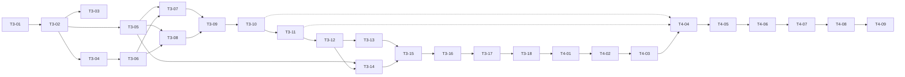

# tasks.md：智能日报生成器（v2）

| 项 | 内容 |
|---|---|
| 关联规范 | `specs/proposal.md`、`specs/design.md` |
| 版本 | v2.0 |
| 纪律 | 一任务 = 一交付物 = 一次提交 = 一次 code-review |

> 提交信息格式：`feat|fix|test|docs|chore: [任务编号] 一句话说明`
> 状态列初始为 `TODO`，完成并验证后改为 `DONE` 并填入提交号。

## 1. 第 3 周任务清单

### 1.1 共享基础层

| 编号 | 任务 | 交付物 | 验收标准（可执行） | 依赖 | 提交 | 状态 |
|---|---|---|---|---|---|---|
| T3-01 | 工程骨架与工具链 | `pyproject.toml`、目录骨架、ruff/pytest 配置、`.env.example`、`.gitignore` | `uv sync` 成功；`ruff check .` 零告警；`pytest -q` 收集到 0 个用例且退出码 5 为预期 | — | 8554384 | DONE |
| T3-02 | 领域模型与异常 | `models.py`、`errors.py` | `pytest tests/test_models.py` 通过：UTC 校验拒绝 naive datetime；`ReportScope` 无默认值；`errors.py` 全部错误码可实例化 | T3-01 | 8554384 | DONE |
| T3-03 | 配置装配 | `config.py` | `pytest tests/test_config.py` 通过：缺失必需环境变量抛 `ConfigError`；任何路径都不在代码中出现真实令牌；`source_mode` 支持 `mock`/`live` | T3-02 | 3bc2a83 | DONE |
| T3-04 | 存储结构与仓储 | `storage/schema.py`、`storage/repository.py` | `pytest tests/test_storage.py` 通过：建表幂等；原始记录重复插入按主键去重；`UNIQUE(team_id, run_date, status)` 生效；所有 SQL 为参数化（测试用 `%` 拼接探针断言抛错） | T3-02 | 1a29188 | DONE |
| T3-05 | 网络请求助手 | `net.py`（`get_json` / `post_json`、按异常类型分流的重试） | `pytest tests/test_net.py` 通过：401/403 不重试抛 `AuthenticationError`；429/5xx/超时重试 2 次后抛 `TransientError`；其它 4xx 不重试 | T3-02 | 8b0fbba | DONE |

### 1.2 采集层

| 编号 | 任务 | 交付物 | 验收标准（可执行） | 依赖 | 提交 | 状态 |
|---|---|---|---|---|---|---|
| T3-06 | 采集端口与 Mock 数据源 | `collectors/base.py`、`collectors/mock.py` | `pytest tests/test_collectors_base.py` 通过：Mock 与 Protocol 签名一致；空区间返回 `[]`；naive datetime 抛 `ValueError` | T3-04 | a220a06 | DONE |
| T3-07 | GitHub 采集实现 | `collectors/github.py` | `pytest tests/test_github_collector.py` 通过：正常区间、空区间、分页截断告警、401 抛 `AuthenticationError` 不重试、429 重试 2 次、提交字段逐项断言（含 `committed_at.tzinfo` 为 UTC） | T3-05、T3-06 | 294ef70 | DONE |
| T3-08 | 飞书任务与消息采集 | `collectors/feishu.py` | `pytest tests/test_feishu_collector.py` 通过：任务状态变更采集；消息撤回置 `is_recalled=True` 且不丢记录；限流退避重试 | T3-05、T3-06 | 1d5d81b | DONE |

### 1.3 生成层

| 编号 | 任务 | 交付物 | 验收标准（可执行） | 依赖 | 提交 | 状态 |
|---|---|---|---|---|---|---|
| T3-09 | 协作归属 | `generation/attribution.py` | `pytest tests/test_attribution.py` 通过：按 GitHub login / 飞书 open_id 归组；未配置映射的成员被跳过并计入 `unmapped`；不按消息发言者推测协作归属 | T3-07、T3-08 | c6db4a7 | DONE |
| T3-10 ⚠受T4-04影响 | 个人日报生成 | `generation/builder.py`（`generate_report` scope=PERSONAL） | `pytest tests/test_builder_personal.py` 通过：条目顺序 提交→任务→消息；每条 `source_id` 非空；无数据返回 `note="无数据"`；缺少某源时 `note` 含"来源缺失：<源>"；`source_id` 为空时抛 `TraceabilityError` | T3-09 | a150edf | DONE |
| T3-11 ⚠受T4-04影响 | 团队日报生成 | `generation/builder.py`（scope=TEAM） | `pytest tests/test_builder_team.py` 通过：按 member_id 分组而非按提交条数拼接；缺失成员列在 `note`；全组无数据仍返回非 `None` | T3-10 | 85a6e8c | DONE |

### 1.4 渲染与推送层

| 编号 | 任务 | 交付物 | 验收标准（可执行） | 依赖 | 提交 | 状态 |
|---|---|---|---|---|---|---|
| T3-12 | 文本与邮件渲染 | `render/text.py` | `pytest tests/test_render.py` 通过：纯函数不改入参（深比较）；团队日报渲染字段完整度 100%；HTML 转义特殊字符 | T3-11 | f0d49e1 | DONE |
| T3-13 | 邮件推送 | `publishers/email.py` | `pytest tests/test_email_pusher.py` 通过：单收件人失败不中断；`SendResult.failed` 覆盖失败项；认证失败立即整批停止；日志邮箱脱敏为 `a***@example.com` | T3-12 | ed48584 | DONE |
| T3-14 | 飞书机器人推送 | `publishers/feishu_bot.py` | `pytest tests/test_feishu_bot.py` 通过：成功返回 `ok=True`；5xx 重试 2 次后 `ok=False`；webhook 缺失抛 `ConfigError` | T3-05、T3-12 | 0aa323d | DONE |

### 1.5 编排与交付

| 编号 | 任务 | 交付物 | 验收标准（可执行） | 依赖 | 提交 | 状态 |
|---|---|---|---|---|---|---|
| T3-15 | 主编排与幂等 | `orchestration/run_daily.py` | `pytest tests/test_run_daily.py` 通过：同日二次运行返回原摘要且不追加记录；单源失败其余继续且 `RunSummary.failed` 可见；推送全失败时日报仍入库 | T3-13、T3-14 | 2252c7d | DONE |
| T3-16 | 命令行入口 | `cli.py`、`__main__.py` | `pytest tests/test_cli.py` 通过：`python -m daily_report run --date` 退出码 0；重复运行退出码 0 并输出"重复触发已忽略"；参数非法退出码 2 | T3-15 | bfbf700 | DONE |
| T3-17 | 集成测试与分层检查 | `tests/test_integration.py`、`tests/test_architecture.py` | 全链路 Mock 采集→生成→推送可重复执行；`test_architecture.py` 断言下层模块不 import `orchestration` | T3-16 | 36a37cf | DONE |
| T3-18 | 质量收口与规范同步 | ruff 零告警、`docs/设计与specs一致性检查记录.md` 真实填写 | `ruff check .` 与 `pytest -q` 全绿；一致性检查记录中每行代码路径可点击且真实存在 | T3-17 | — | DONE |

## 2. 第 4 周任务清单（变更涟漪演练 + 交付）

| 编号 | 任务 | 交付物 | 验收标准（可执行） | 依赖 | 提交 | 状态 |
|---|---|---|---|---|---|---|
| T4-01 | 变更单受理与规范同步 | `proposal.md` 新增 R-11、`design.md` 新增 3.6 接口契约与 ADR-005 | 文档 diff 中可看到范围、接口、数据模型三处同步；`docs/变更涟漪演练记录.md` 记录变更单原文与影响面 | T3-18 | TODO |
| T4-02 | 任务与依赖更新 | `tasks.md` 新增 T4-03~T4-05 并更新依赖图 | 新增任务均有验收标准；依赖图中 `affected` 标记指向被修改的 T3-09/T3-10 | T4-01 | TODO |
| T4-03 | 考勤采集实现 | `models.AttendanceRecord`、`collectors/feishu.py` 新增 `collect_attendance`、`collectors/mock.py` 同步 | `pytest tests/test_attendance.py` 通过：区间采集、缺勤记录、空区间返回 `[]` | T4-02 | TODO |
| T4-04 | 生成层容纳考勤条目 | `generation/builder.py` 接入考勤来源 | `pytest tests/test_builder_team.py` 新增用例通过：考勤条目按配置位置插入；`source_id` 可追溯 | T4-03 | TODO |
| T4-05 | 全量回归 | `tests/test_regression.py` | 从 `proposal.md` 成功标准逐条导出用例；`pytest -q` 全绿；`docs/回归测试执行报告.md` 逐条核对通过 | T4-04 | TODO |
| T4-06 | 规范守护自检 | `scripts/check_spec_drift.py` 或 git hook | 修改 `src/` 而未修改 `specs/` 时脚本退出码非 0 并列出文件；`docs/规范守护自检记录.md` 有真实运行输出 | T4-05 | TODO |
| T4-07 | 安全自检 | 检索报告 | 全仓检索无令牌明文、无字符串拼接 SQL；日志脱敏用例通过；`docs/安全自检记录.md` 附检索命令与输出 | T4-06 | TODO |
| T4-08 | 答辩追问清单与模拟答辩 | `docs/答辩追问清单.md`、`docs/模拟答辩记录.md` | 追问覆盖架构 ADR、安全、异常处理、并发与幂等四类，每问有可核对答案 | T4-07 | TODO |
| T4-09 | 总结与审计报告 | `docs/项目总结报告.md`、`docs/规范审计报告.md`、`docs/AI使用合规声明.md` | 质量数据均来自真实 `pytest --cov` 与 `ruff` 输出；两阶段对比数据标注来源；无编造数据 | T4-08 | TODO |

## 3. 依赖图

## 4. 并行组

| 并行组 | 任务 | 共享文件 | 说明 |
|---|---|---|---|
| P1 | T3-07 / T3-08 | 无 | 两个采集器分属不同文件，端口已定，可并行 |
| P2 | T3-13 / T3-14 | 无 | 两个推送渠道互不依赖 |
| P3 | T3-03 / T3-04 | 无 | 配置与存储无相互依赖 |

**必须串行**的共享文件：`models.py`（T3-02 唯一）、`generation/builder.py`（T3-10、T3-11、T4-04）、`orchestration/run_daily.py`（T3-15）、`specs/*.md`（每次变更单次提交）。

## 5. 范围覆盖核对

| 范围条目 | 承接任务 | 状态 |
|---|---|---|
| R-01 GitHub 采集 | T3-07 | TODO |
| R-02 飞书任务采集 | T3-08 | TODO |
| R-03 飞书消息采集 | T3-08 | TODO |
| R-04 个人日报 | T3-10 | TODO |
| R-05 团队日报 | T3-11 | TODO |
| R-06 邮件推送 | T3-13 | TODO |
| R-07 飞书机器人推送 | T3-14 | TODO |
| R-08 历史存储与查询 | T3-04、T3-15 | TODO |
| R-09 映射配置 | T3-03、T3-08 | TODO |
| R-10 定时与幂等 | T3-15、T3-16 | TODO |
| R-11 考勤采集（第 4 周变更） | T4-03、T4-04 | TODO |
